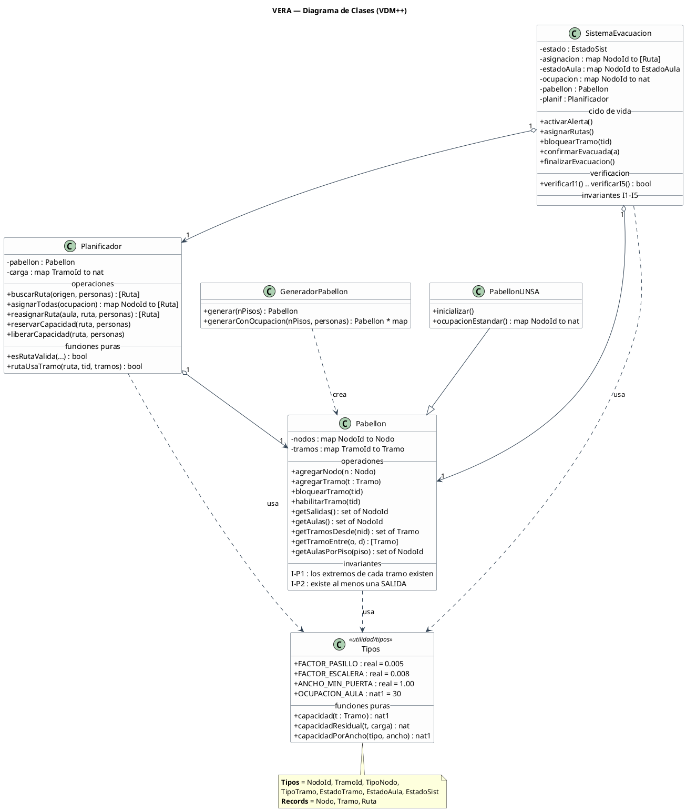
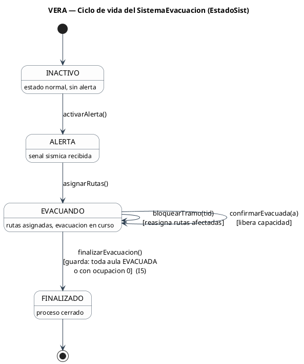
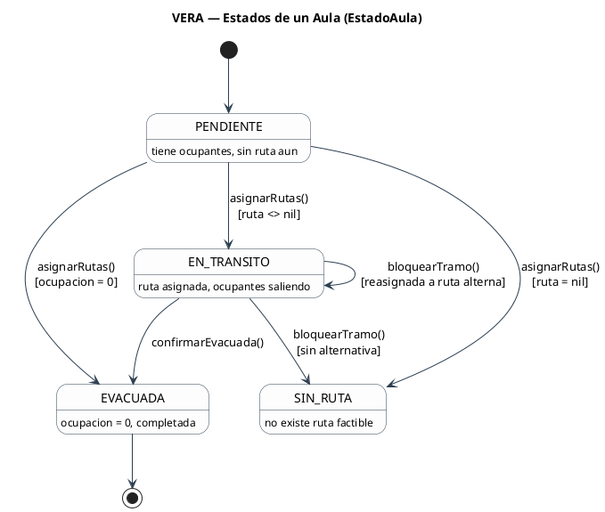
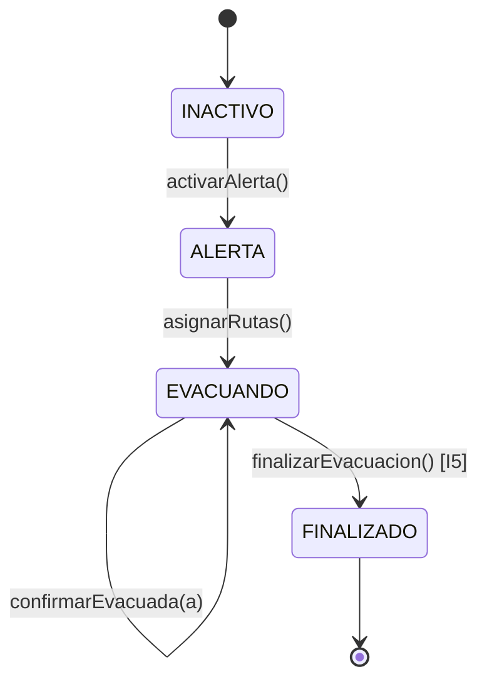
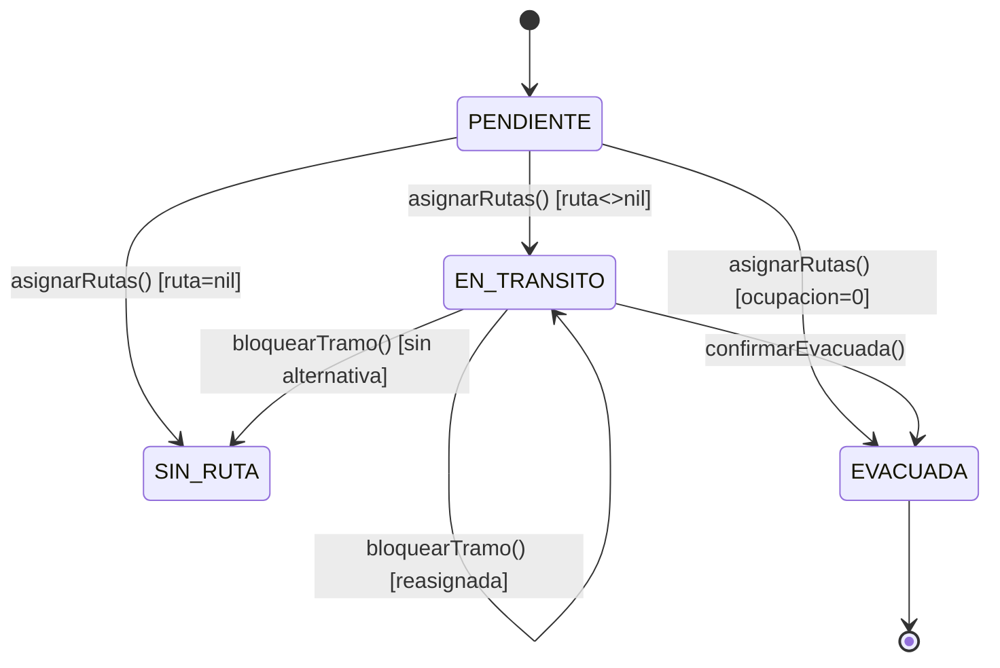
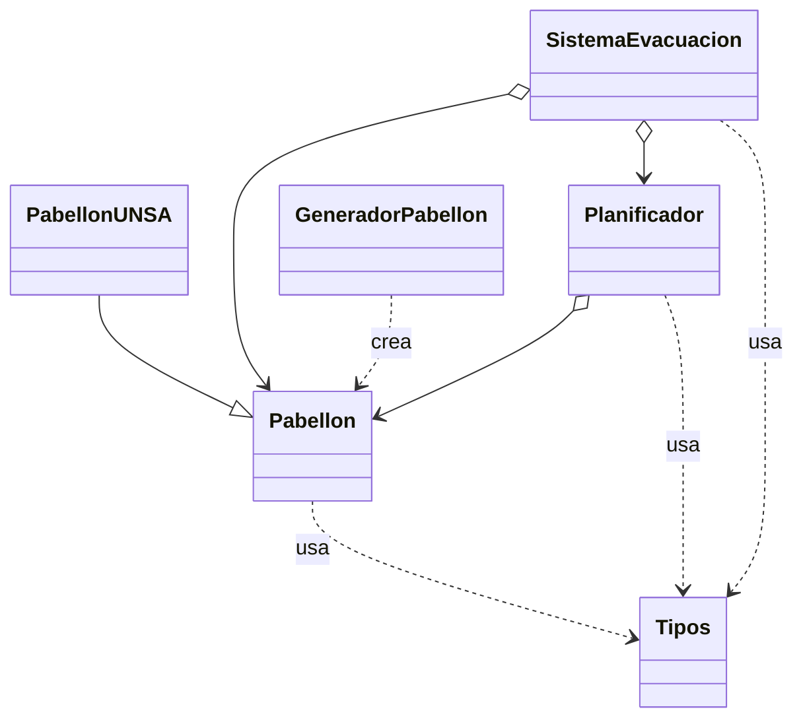

# VERA — Diagramas UML

Diagramas de la especificación VDM++ (issue #18). Fuentes en **PlantUML**
(`.puml`) y versiones **Mermaid** editables abajo. Los PNG se ven directamente
en GitHub.

## 1. Diagrama de clases



Seis clases en dos capas: **datos** (`Tipos`, `Pabellon`, `PabellonUNSA`,
`GeneradorPabellon`) y **lógica** (`Planificador`, `SistemaEvacuacion`).
`PabellonUNSA` hereda de `Pabellon`; `SistemaEvacuacion` agrega un `Pabellon` y
un `Planificador`.

## 2. Diagrama de estados — SistemaEvacuacion



Ciclo de vida `INACTIVO → ALERTA → EVACUANDO → FINALIZADO` (tipo `EstadoSist`).
Durante `EVACUANDO`, `bloquearTramo` y `confirmarEvacuada` son transiciones
internas (reasignación y liberación de capacidad).

## 3. Diagrama de estados — Aula



Estados de evacuación de cada aula (tipo `EstadoAula`).

---

## Cómo regenerar los PNG

```sh
# requiere Java + Graphviz (dot); plantuml.jar se descarga una vez
java -jar plantuml.jar -tpng *.puml
```
O con la extensión **PlantUML** de VS Code: abrir el `.puml` → `Alt+D` para
previsualizar, exportar a PNG/SVG.

---

## Versiones Mermaid (editables sin PlantUML)

### Estados del sistema


### Estados del aula


### Clases (resumen)

